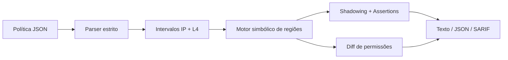

<div align="center">

# FenceProof

**Verificação offline de regras de firewall, com evidências matemáticas de alcance e mudanças de exposição**

[](https://www.python.org/)
[](LICENSE)
[](https://github.com/felipewatter/fenceproof/actions/workflows/ci.yml)
[](docs/THREAT_MODEL.md)
[](https://docs.github.com/en/code-security/concepts/code-scanning/sarif-files)

Projeto de portfólio DevSecOps · Autor: [@felipewatter](https://github.com/felipewatter)

</div>

> **O FenceProof é um laboratório de análise formal de ACLs stateless.** Trabalha exclusivamente com políticas JSON em um modelo próprio e explícito. Ele não varre redes, não altera firewalls, não requer credenciais ou banco de dados e não garante que um firewall real corresponda ao modelo.

## Índice

1. [Por que este projeto existe?](#por-que-este-projeto-existe)
2. [Funcionalidades](#funcionalidades)
3. [Demonstração rápida](#demonstração-rápida)
4. [Instalação](#instalação)
5. [Uso da CLI](#uso-da-cli)
6. [Como funciona](#como-funciona)
7. [Formato de política](#formato-de-política)
8. [Códigos e interpretação dos achados](#códigos-e-interpretação-dos-achados)
9. [Integração com CI/CD](#integração-com-cicd)
10. [Testes e qualidade](#testes-e-qualidade)
11. [Segurança e limites](#segurança-e-limites)
12. [Documentação](#documentação)
13. [Contribuições, licença e referências](#contribuições-licença-e-referências)

## Por que este projeto existe?

Um conjunto de regras de firewall pode aparentar estar correto, mas conter **regras que nunca entram em vigor** ou **alterações que ampliam acesso sem intenção**. Identificar esses casos examinando apenas a configuração linha a linha é difícil, sobretudo quando múltiplas regras anteriores se sobrepõem.

O FenceProof representa cada regra como intervalos de IP de origem, IP de destino e porta, separados por família (IPv4/IPv6) e protocolo (TCP/UDP/ICMP). Um algoritmo de subtração de conjuntos calcula a porção efetivamente alcançável das regras. Com isso, a ferramenta responde a perguntas como:

- Uma regra permissiva ficou totalmente encoberta por duas regras anteriores?
- Uma regra foi parcialmente anulada pela precedência?
- Determinado fluxo seria permitido ou negado **neste modelo**?
- Quais conjuntos de fluxos passaram a ser permitidos ou negados após uma mudança?
- Uma hipótese de segurança (“SSH somente da rede operacional”) continua verdadeira?
- O arquivo foi analisado integralmente ou a análise precisou ser interrompida por limite de recursos?

### Distinção em relação a outros projetos

A ferramenta concentra-se na **equivalência semântica de políticas ordenadas e em testemunhas de tráfego**. Não é um scanner de CVEs, de tokens, de segredos, de dependências, de conteúdo HTTP ou de integridade de arquivos.

## Funcionalidades

| Recurso | Implementação | Garantia ou restrição |
| --- | --- | --- |
| Motor de ACL | `first-match-wins` em regras `allow` e `deny` | Modelo stateless próprio, sem mapeamento automático para vendors |
| IP | Intervalos IPv4 e IPv6 | Famílias avaliadas separadamente |
| L4 | TCP, UDP, ICMP; portas TCP/UDP e faixas | `any` significa apenas os três protocolos definidos |
| Shadowing | Regra totalmente ou parcialmente preemptada, inclusive por união | Exato no modelo, respeitando limites de fragmentos |
| Simulação | Fluxo origem/destino/protocolo/porta | Resultado da avaliação local, não teste de conectividade |
| Diff semântico | Conjuntos `newly_allowed` e `newly_denied` | Exato no modelo; amostras são testemunhas ilustrativas |
| Assertions | Fluxos e decisões esperadas | Falha de assert gera achado `FP005` |
| Exposição administrativa | Heurística de origem /0 com IPs públicos de referência | Não cobre toda a Internet nem comprova exposição real |
| Relatórios | Texto legível, JSON, SARIF 2.1.0 | Ordenados, determinísticos, SHA-256 no JSON da análise |
| Guardas de recursos | Limites de input e fragmentos | Se esgotado, **INCONCLUSIVO / exit 3** |
| CI | Testes e smoke em 3 sistemas e 3 versões Python | O workflow remoto requer execução no GitHub |
| Release | Workflow após CI bem-sucedida na `main` | Publica `v1.0.0` somente se ainda não existir |

**Stack:** Python 3.11+, biblioteca padrão em runtime, tipagem, `dataclasses`, `ipaddress`, `argparse`, `unittest`. Nenhum serviço externo é necessário para analisar uma política.

## Demonstração rápida

```bash
# Clonar depois que o repositório estiver publicado:
git clone https://github.com/felipewatter/fenceproof.git
cd fenceproof

# Instalar a CLI:
python -m pip install .

# Política segura: espera-se exit 0:
fenceproof check --policy examples/secure-policy.json

# Política insegura: gera FP002, FP004 e FP005; espera-se exit 2:
fenceproof check --policy examples/risky-policy.json

# Mudança semântica entre as duas políticas:
fenceproof diff --before examples/secure-policy.json \
  --after examples/risky-policy.json --format json --fail-on-change

# Um fluxo específico:
fenceproof simulate --policy examples/secure-policy.json \
  --src 1.1.1.1 --dst 10.20.0.10 --protocol tcp --port 22
```

**Exemplo de saída de `check` para a política insegura:**

```text
FenceProof | staging-perimeter-risky | complete
Rules: 4 | Assertions: 0/1
[HIGH] FP004 (public-ssh): Administrative TCP service reachable from a sampled public IP.
[MEDIUM] FP002 (allow-ssh-ops): Rule is completely unreachable due to prior rules.
[HIGH] FP005: Security assertion failed.
```

**Como interpretar:** A regra `public-ssh` está antes de `allow-ssh-ops` e admite o acesso de IP de referência ao SSH segundo o modelo. A regra de escritório nunca é alcançada, e a expectation de negar o SSH externo falha. A ferramenta não executa nenhuma conexão TCP.

### Sem instalação (executar a partir do código)

Linux/macOS:

```bash
PYTHONPATH=src python3 -m fenceproof check --policy examples/secure-policy.json
```

PowerShell:

```powershell
$env:PYTHONPATH = "src"
py -m fenceproof check --policy examples/secure-policy.json
```

## Instalação

### Requisitos

- Python **3.11 ou superior**.
- Permissão de leitura para o arquivo JSON a ser analisado.
- Nenhuma credencial, chave de API, Docker, banco de dados ou acesso à rede é exigido **em tempo de execução**.
- A instalação via `pip` poderá buscar dependências do sistema de build (`setuptools`) caso indisponíveis localmente.

```bash
python -m venv .venv
# Linux/macOS: source .venv/bin/activate
# Windows PowerShell: .venv\Scripts\Activate.ps1
python -m pip install .
fenceproof --help
```

## Uso da CLI

### `check`: análise com gate de segurança

```bash
fenceproof check --policy examples/secure-policy.json \
  --format json --output policy.report.json --fail-on medium
```

Valores de `--format`: `text` (padrão), `json`, `sarif`. Valores de `--fail-on`: `high` (padrão), `medium`, `low`, `none`. O gate `high` não bloqueia `FP002` e `FP003`; `medium` bloqueia `FP001`, `FP002`, `FP004`, `FP005`; `low` bloqueia qualquer achado.

```bash
fenceproof check --policy examples/risky-policy.json \
  --format sarif --output audit.sarif --fail-on none
```

A opção `--fail-on none` permite gerar relatórios sem bloquear o pipeline, **mas não altera os achados**. Não interprete exit `0` como aprovação universal.

### `simulate`: resultado de um fluxo

```bash
fenceproof simulate --policy examples/secure-policy.json \
  --src 10.10.0.50 --dst 10.20.0.10 --protocol tcp --port 22 --format json
```

Saída inclui `decision` (`allow`/`deny`), `matched_rule` e `default_used`.

Para ICMP, use `--protocol icmp --port 0`. A porta `0` é apenas uma representação interna, não um tipo/código ICMP.

### `diff`: comparar conjuntos permitidos

```bash
fenceproof diff --before examples/secure-policy.json \
  --after examples/risky-policy.json --samples 5 \
  --format json --output diff.report.json --fail-on-change
```

O relatório distingue `newly_allowed_regions` e `newly_denied_regions`. **Essas contagens são fragmentos simbólicos, não número de pacotes, hosts ou serviços**. `--samples 5` limita o número de exemplos retornados, não o alcance do algoritmo. Ao passar `--fail-on-change`, qualquer mudança bloqueia o pipeline (exit `2`).

### Limites e códigos de saída

```bash
fenceproof check --policy examples/secure-policy.json --max-fragments 5000
```

| Código | Significado |
| ---: | --- |
| `0` | Análise concluída e sem falhas no limiar configurado (ou diff sem gate). |
| `1` | Entrada/parâmetros inválidos, falha de leitura ou escrita. |
| `2` | Achado que ultrapassa limiar ou diff com alteração sob `--fail-on-change`. |
| `3` | **INCONCLUSIVO**: limite de fragmentação excedido. Nunca considere `3` como sucesso. |

Há também orçamento interno de 2.000.000 operações de subtração por análise, com exit `3` quando ultrapassado. O arquivo JSON tem limite de 1 MiB; máximo 500 regras, 1.000 assertions e 128 intervalos declarados por regra. `--max-fragments` aceita de 100 a 100.000; padrão de 10.000. Execute sempre com timeout externo em ambientes de múltiplos usuários.

## Como funciona



Para cada protocolo e família IP, uma regra define uma caixa `src × dst × port`. O motor subtrai a união das regras anteriores, preservando somente o tráfego ainda alcançável. Ao comparar políticas, calcula-se a diferença entre os conjuntos **efetivamente permitidos**, inclusive quando o default é `allow`.

O método produz testemunhas concretas de mudança. Não depende de amostragem para decidir se o `diff` mudou; a amostragem limita apenas as testemunhas apresentadas. Veja a explicação algorítmica em [ARCHITECTURE.md](docs/ARCHITECTURE.md).

## Formato de política

```json
{
  "version": 1,
  "name": "rede-exemplo",
  "default_action": "deny",
  "rules": [
    {
      "id": "permitir-ssh-ops",
      "action": "allow",
      "src": "10.10.0.0/24",
      "dst": "10.20.0.10/32",
      "protocol": "tcp",
      "ports": [22]
    }
  ],
  "assertions": [
    {
      "id": "ssh-externo-negado",
      "flow": {
        "src": "1.1.1.1",
        "dst": "10.20.0.10",
        "protocol": "tcp",
        "port": 22
      },
      "expect": "deny"
    }
  ]
}
```

Regras têm identificadores únicos, IPs em CIDRs canônicos, protocolo `tcp`, `udp`, `icmp` ou `any`, e `ports` (apenas TCP/UDP) como lista de números ou intervalos inclusivos `[início,fim]`. `any4` é `0.0.0.0/0`; `any6` é `::/0`. CIDR de origem e destino devem compartilhar família. O `any` cobre exclusivamente TCP, UDP e ICMP, **não todos os protocolos IP existentes**.

Leia a especificação completa, incluindo semântica, validações e defaults: [POLICY_FORMAT.md](docs/POLICY_FORMAT.md).

## Códigos e interpretação dos achados

| Código | Gravidade | Significado |
| --- | --- | --- |
| `FP001` | Alta | Ação padrão é `allow` (risco de política permissiva). |
| `FP002` | Média | Regra totalmente encoberta pela precedência. |
| `FP003` | Baixa | Regra parcialmente encoberta. |
| `FP004` | Alta | Porta administrativa TCP permitida para ao menos um IP público amostrado, com regra de origem /0. **Heurística limitada.** |
| `FP005` | Alta | Assertion de fluxo falhou. |

FP004 analisa apenas as portas 22, 23, 3389, 3306, 5432, 6379 e 9200 e IPs públicos de referência detalhados na arquitetura. **Não conclui que o serviço está acessível pela Internet real**; outras ACLs, NAT, roteamento e estado não são modelados.

## Integração com CI/CD

Os workflows em `.github/workflows/` usam ações fixadas em commits SHA e permissões mínimas por job:

- **`ci.yml`:** matriz Python 3.11/3.12/3.13 × Ubuntu/Windows/macOS; compilação, 43 testes, smoke da política segura e geração/parse de SARIF.
- **`release.yml`:** observa apenas CI concluída com sucesso para `push` na branch `main`, do mesmo repositório. Publica a release `v1.0.0` com as notas de `RELEASE_NOTES.md`, um ZIP do código e seu SHA-256, se ela ainda não existir. Exige que o GitHub Actions esteja habilitado e que o token do workflow tenha permissão `contents: write` (declarada no job).
- **`dependabot.yml`:** propõe revisões mensais das referências de GitHub Actions.

### Uso em outro repositório como policy gate

```yaml
- name: Validar política de rede
  run: |
    PYTHONPATH=src python -m fenceproof check \
      --policy examples/secure-policy.json \
      --fail-on medium
```

O exemplo supõe que o projeto está presente no diretório de trabalho; adapte a etapa de instalação do pacote para outras organizações. SARIF pode ser integrado ao GitHub Code Scanning, sujeito às permissões/configuração da conta. A geração do arquivo SARIF **não** faz upload automático.

## Testes e qualidade

```bash
# Linux/macOS
make check

# Sem make, em qualquer sistema (após instalar o projeto):
python -m compileall -q src tests
python -m unittest discover -s tests -v
fenceproof check --policy examples/secure-policy.json --fail-on low
```

A matriz inclui validação negativa de JSON, intervalos, regras, assertions, exceções e códigos de saída. O teste mais importante confronta o `diff` simbólico com um **oráculo que enumera pacotes** em 80 pares de políticas pequenas com semente fixa. Outro teste percorre 27 casos de decomposição de caixas para verificar cobertura exata e ausência de sobreposição.

Veja [TEST_MATRIX.md](docs/TEST_MATRIX.md) e a [evidência de validação local](docs/VALIDATION_REPORT.md). **Resultados locais não equivalem a CI remoto aprovado**; a execução no GitHub deve ser conferida após a publicação.

## Segurança e limites

### O que o FenceProof não faz

- Não realiza análise de vulnerabilidades em dispositivos, serviços ou infraestrutura de terceiros.
- Não faz port scanning, descoberta de ativos, conexões remotas ou importação de configuração de fabricantes.
- Não interpreta regras NAT, roteamento, VPN, estado de sessão, firewall por aplicação, identidade, direção/interface, zonas ou protocolos IP além dos definidos.
- Não garante que equipamentos reais adotam a mesma prioridade; **somente** regras `first-match-wins` neste formato.
- Não assina relatórios: SHA-256 detecta diferença de bytes, mas não autentica origem.
- Não substitui revisão humana, testes em homologação ou análise de configuração real por profissionais autorizados.

O parser rejeita chaves duplicadas, campos inesperados, JSON inválido e regras inconsistentes. A análise deixa de concluir se exceder o orçamento de fragmentos. Arquivos e relatórios podem conter endereços internos sensíveis; utilize exemplos sintéticos em repositórios públicos.

Relatos de segurança: [SECURITY.md](SECURITY.md). Hipóteses, ameaças e riscos residuais: [THREAT_MODEL.md](docs/THREAT_MODEL.md).

## Documentação

| Documento | Conteúdo |
| --- | --- |
| [Arquitetura](docs/ARCHITECTURE.md) | Semântica, representação simbólica, prova de completude, limites e heurísticas. |
| [Formato de políticas](docs/POLICY_FORMAT.md) | Esquema v1, exemplos, portas, actions, assertions e exit codes. |
| [Modelo de ameaças](docs/THREAT_MODEL.md) | STRIDE, ativos protegidos, fronteiras de confiança, ameaças e riscos residuais. |
| [Matriz de testes](docs/TEST_MATRIX.md) | Testes unitários, diferenciais, smoke e CI. |
| [Relatório de validação local](docs/VALIDATION_REPORT.md) | 43 testes, cobertura, instalação wheel e limites da evidência. |
| [Política de segurança](SECURITY.md) | Processo de divulgação responsável e versões suportadas. |
| [Contribuição](CONTRIBUTING.md) | Fluxo de PR, critérios de revisão e higiene de segurança. |
| [Changelog](CHANGELOG.md) | Histórico de versões. |
| [Release notes](RELEASE_NOTES.md) | Funcionalidades e limites da versão v1.0.0. |

## Contribuições, licença e referências

Contribuições são bem-vindas através de pull requests com testes, entradas sanitizadas e documentação da alteração de comportamento. Consulte [CONTRIBUTING.md](CONTRIBUTING.md).

**Licença:** MIT — [LICENSE](LICENSE). **Autor:** Felipe Watter — [@felipewatter](https://github.com/felipewatter).

### Fontes técnicas

- NIST SP 800-41 Rev. 1 — *Guidelines on Firewalls and Firewall Policy*: https://csrc.nist.gov/pubs/sp/800/41/r1/final
- Cisco Secure Firewall — ordem e avaliação de regras de acesso: https://www.cisco.com/c/en/us/td/docs/security/secure-firewall/management-center/device-config/740/management-center-device-config-74/access-rules.html
- GitHub Docs — SARIF 2.1.0 para Code Scanning: https://docs.github.com/en/code-security/concepts/code-scanning/sarif-files
- OASIS SARIF v2.1.0 — padrão de intercâmbio de resultados: https://docs.oasis-open.org/sarif/sarif/v2.1.0/os/sarif-v2.1.0-os.pdf

> As referências informam a motivação e o formato de integração, não implicam certificação, auditoria ou endosso por essas organizações.
